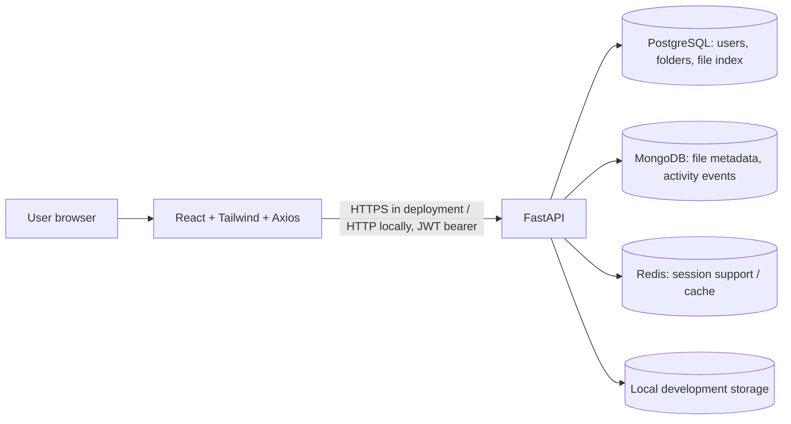

# TrustShare Milestone 1 — Architecture & Design

## Architecture

## Responsibilities
- **React/Vite/Tailwind:** registration, login, password-recovery UI foundation, dashboard, file search, upload, folders, download/delete.
- **FastAPI:** authentication, authorization, file validation and ownership checks.
- **PostgreSQL:** users, roles, folder records, canonical file index.
- **MongoDB:** upload metadata copies and activity events (login, registration, upload, download, delete, folder creation).
- **Redis:** optional session support. The API remains available if Redis is unavailable in local development.
- **Local storage:** raw uploaded bytes for Milestone 1 only.

## Data model
- `users(id, name, email, password_hash, role, created_at)`; role values: `admin`, `user`, `guest`.
- `folders(id, name, owner_id, created_at)`.
- `files(id, original_name, stored_name, content_type, size, sha256, owner_id, folder_id, uploaded_at)`.
- MongoDB `files`: metadata document with file id, original name, size, content type, owner, folder, upload time and storage identifier.
- MongoDB `activity`: event name, user id, details and timestamp.

## Security decisions / scope
Passwords are bcrypt-hashed; authentication uses expiring JWTs; private endpoints require a bearer token; file list/download/delete are scoped to the authenticated owner; admin user listing requires the `admin` role; uploads enforce an extension allowlist and 10 MiB limit by default; generated storage names avoid path traversal and collisions. Extension validation is a milestone-level check, not malware scanning or MIME sniffing. Use HTTPS, strong secrets, rate limiting, database backups, robust token revocation and security review before production.

MFA and OAuth are foundations only, and password reset UI is a placeholder. AES-256 encryption, key management, cloud object storage and sharing links are explicitly Milestone 2.
